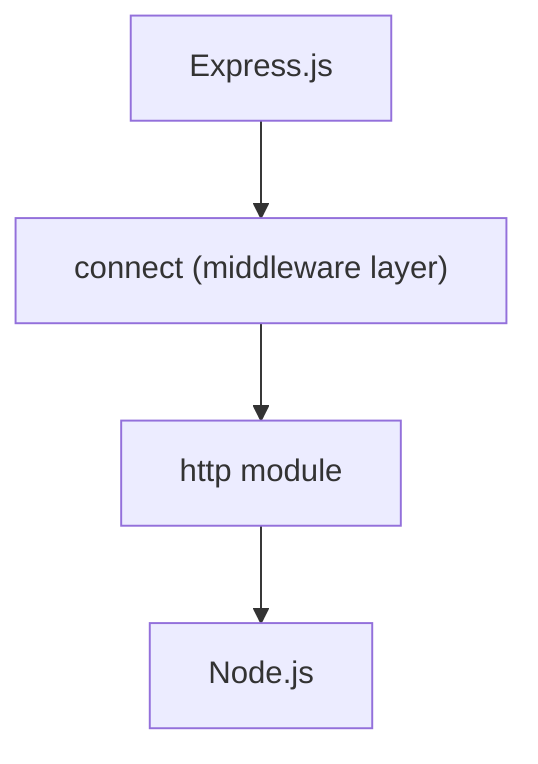
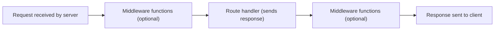
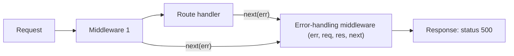
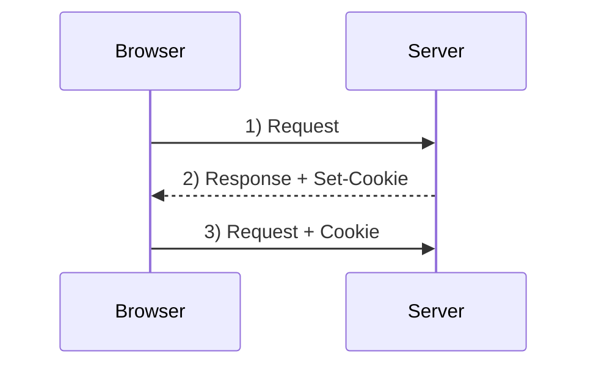
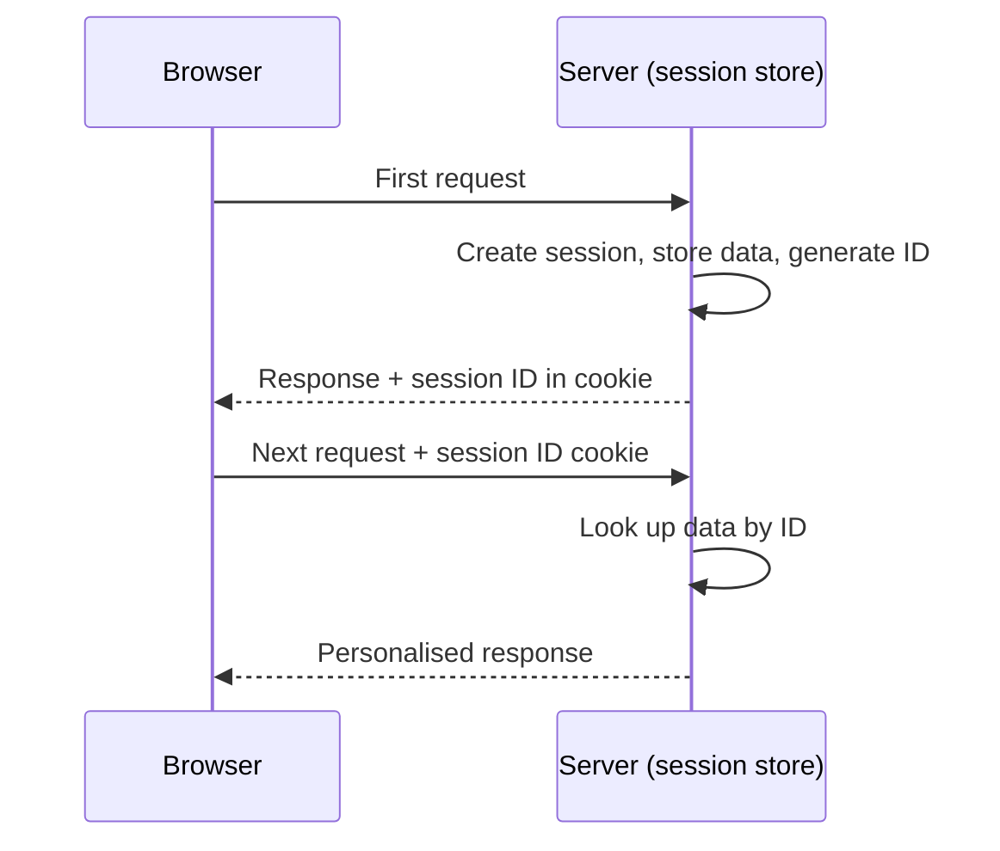
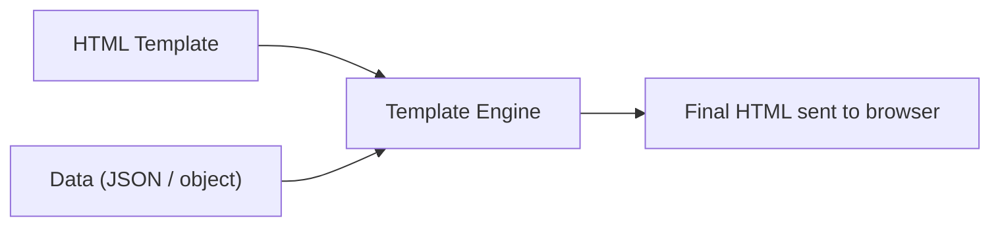

# 2. Express.js

> [!NOTE]
> Source: `express_js.pdf` (new). This replaces the earlier short section. Topics still **absent from the PDF** are marked 🔴 (Express Generator, Router, REST CRUD).

## 2.1 Introduction ✅

- **Express.js** is a **web application framework for Node.js**.
- It makes web development **fast and easy**, which otherwise takes more time using only Node.js.
- It is based on the Node.js middleware module **`connect`**, which in turn uses the **`http`** module. So any `connect`-based middleware also works with Express.



⚠️ **CORRECTION:** From **Express 4 onward** the `connect` dependency was removed; Express has its own router and middleware system. The **connect-style** `(req, res, next)` middleware still works, so the idea in the slide is right for exams, but do not say "Express needs connect" in modern terms.

### Advantages ✅
1. Makes Node.js web development **fast and easy**.
2. **Easy to configure and customise**.
3. **Routes** defined by HTTP method and URL.
4. Many **middleware** modules for extra work on request/response.
5. Easy integration with **template engines** (Jade/Pug, Vash, EJS).
6. Lets you define **error-handling middleware**.
7. Easy to **serve static files** and resources.
8. Lets you create a **REST API server**.
9. Easy to connect to **databases**: MongoDB, Redis, MySQL.

### Features ✅
- Speeds up development.
- Builds **single-page, multi-page and hybrid** web and mobile apps.
- Works with templating engines: **Pug, Mustache, EJS**.
- Integrates easily with MongoDB, Redis, MySQL.
- Defines **error-handling middleware**.
- Simplifies configuration and customisation.
- "Follows MVC" (as per slide) ⚠️ Express is **unopinionated**: it does not force MVC, but you can organise code as MVC (routes = controller, views = template engine, model = MongoDB/Mongoose).

🔁 **COMPARE: Plain Node `http` vs Express**

| Point | Node `http` module | Express |
|---|---|---|
| Routing | Manual `if (req.url == ...)` | `app.get()`, `app.post()` |
| Body parsing | Manual stream handling | `express.json()` |
| Middleware | Not available | Core concept |
| Static files | Write code yourself | `express.static()` |
| Template engines | None | Pug, EJS, Handlebars |
| Error handling | Manual | Error-handling middleware |
| Code size | Long | Short |
| Level | Low-level core module | Framework on top |

## 2.2 Installation and First Program ✅

```bash
npm install -g express          # global (as per slide)
npm install express --save      # local, into your project folder
```
⚠️ Modern practice: install **locally only** (`npm init -y` then `npm install express`). `--save` is now the default.

```js
var express = require('express');
var app = express();
app.get('/', function (req, res) {
  res.send("Hello world!");
});
app.listen(3000);
```

## 2.3 Express Generator 🔴 MISSING NOTE (listed in agenda, no slide)

- **Express Generator** is a command-line tool that **creates a ready-made application skeleton**.
- Command: `npx express-generator myapp --view=ejs` then `cd myapp`, `npm install`, `npm start` (opens on port **3000**).

| Folder / file | Purpose |
|---|---|
| `bin/www` | Server start-up script |
| `app.js` | Main app: middleware setup and routes |
| `routes/` | Route files (`index.js`, `users.js`) |
| `views/` | Template files |
| `public/` | Static files (CSS, JS, images) |
| `package.json` | Dependencies and scripts |

## 2.4 Routing and HTTP Methods ✅

**Routing** = determining how an application responds to a client request to a **particular path (URI) with a particular HTTP method**. Each route can have **more than one handler function**.

**Structure:** `app.METHOD(PATH, HANDLER)`
- `app` = instance of Express (any variable name works)
- **METHOD** = HTTP method (`get`, `post`, `put`, `delete`)
- **PATH** = route on the server
- **HANDLER** = callback executed when the route matches

**Key functions**

| Function | Description |
|---|---|
| `app.get(route, callback)` | What to do when a GET request arrives at the route. Callback has `req` and `res` |
| `req` (request object) | Holds query string, parameters, body, HTTP headers |
| `res` (response object) | The HTTP response sent back |
| `res.send()` | Sends the response to the client |
| `app.listen(port, [host], [backlog], [callback])` | Binds and listens for connections. **Only `port` is required** |

**`app.listen` arguments**

| Argument | Description |
|---|---|
| `port` | Port number for incoming requests (**required**) |
| `host` | Domain name. Set it when deploying to cloud |
| `backlog` | Max queued pending connections. **Default 511** |
| `callback` | Called when server starts listening |

**HTTP methods**

| Method | Purpose | CRUD |
|---|---|---|
| **GET** | Request a representation of a resource. Only retrieves data, no side effects | Read |
| **POST** | Ask server to accept enclosed data as a **new** object of the resource | Create |
| **PUT** | Ask server to accept enclosed data as an **alteration to an existing** object | Update |
| **DELETE** | Ask server to **delete** a specific resource | Delete |

```js
app.get('/students/:id', (req, res) => res.json({ id: req.params.id }));   // route parameter 🔴
app.post('/students',   (req, res) => res.status(201).json(req.body));     // needs express.json()
app.put('/students/:id',   (req, res) => res.send('Updated ' + req.params.id));
app.delete('/students/:id', (req, res) => res.send('Deleted ' + req.params.id));
```

**Router (modular routes)** 🔴
```js
// routes/students.js
const router = require('express').Router();
router.get('/', (req, res) => res.send('All students'));
module.exports = router;
// app.js
app.use('/students', require('./routes/students'));
```

🔁 **COMPARE: GET vs POST**

| Point | GET | POST |
|---|---|---|
| Purpose | Read data | Create data |
| Data location | URL query string | Request body |
| Side effects | None (safe) | Changes server data |
| Data in URL / bookmark | Visible / can bookmark | Hidden / cannot |

## 2.5 Static Files ✅

**`express.static(root, [options])`**
- Built-in middleware function, based on `serve-static`.
- Serves **static files** (HTML, CSS, JS, images).
- `root` = directory from which to serve. File is found by combining `req.url` with `root`.
- If a file is **not found**, it does **not** send 404; it calls **`next()`** so the next middleware can run (stacking and fall-backs).

```js
app.use(express.static('public'));                 // http://localhost:3000/style.css
app.use('/static', express.static('public'));      // http://localhost:3000/static/style.css
```

## 2.6 Middleware ✅

**Middleware** = functions invoked by the Express **routing layer before the final request handler**. They sit **in the middle** between the request and the intended route. They run **in the order they are added** (stack).

**A middleware function can**
1. Execute any code.
2. Make changes to the **request and response** objects.
3. **End** the request-response cycle.
4. Call the **next** middleware in the stack (`next()`).

**Common uses:** body parsing (URL-encoded/JSON), cookie parsing, serving static files, logging, authentication.

**Anatomy:** `app.get('/', function (req, res, next) { next(); });`
- `get` = HTTP method it applies to · `'/'` = path · function = the middleware
- `req` = request · `res` = response · `next` = callback to pass control (by convention)



**Writing and using middleware** (agenda items) 🔴
```js
// WRITING: custom logger
function logger(req, res, next) {
  console.log(req.method, req.url);
  next();                       // if omitted, the request hangs
}
// USING: app level, for every request
app.use(logger);
// USING: only on one route
app.get('/admin', logger, (req, res) => res.send('Admin'));
```

**Types of middleware ✅**

| Type | Meaning | Example |
|---|---|---|
| **Application-level** | Bound to `app` with `app.use()` / `app.METHOD()` | `app.use(logger)` |
| **Router-level** | Bound to an `express.Router()` instance | `router.use(...)` |
| **Error-handling** | Has **4 arguments** `(err, req, res, next)` | see §2.7 |
| **Built-in** | Ships with Express | `express.static`, `express.json`, `express.urlencoded` |
| **Third-party** | Installed with npm | `body-parser`, `cookie-parser`, `express-session` |

**Third-party: `body-parser` ✅** (parses request bodies with payloads)
```js
var bodyParser = require('body-parser');
app.use(bodyParser.urlencoded({ extended: false }));   // URL-encoded form data
app.use(bodyParser.json());                            // JSON data
```
⚠️ **MODERN NOTE:** Since Express 4.16, use built-in `app.use(express.urlencoded({ extended: false }))` and `app.use(express.json())`. No extra install is needed.

## 2.7 Error Handling ✅

- Error handling in Express is done using **middleware** with a special property: it **must have four arguments: `err, req, res, next`**.
- `next()` goes to the next middleware/handler. **`next(err)`** **skips all normal middleware** and goes to the next **error handler**.
- Place the error handler **after all routes**. It can check error types and respond accordingly. This separates error logic from normal logic.

```js
app.get('/', function (req, res, next) {
  var err = new Error("Something went wrong");
  next(err);                                     // pass error onward
});

// error-handling middleware (4 arguments, defined last)
app.use(function (err, req, res, next) {
  console.error(err.stack);
  res.status(500).send('Something broke!');
});
```
⚠️ **CORRECTION:** The PDF's route is written `function(req, res)` but calls `next(err)`. `next` must be declared as the **third parameter**, as shown above.



## 2.8 Cookies ✅

**Cookie** = small piece of information **sent from a website and stored in the user's browser**. Every time the user loads the site again, the browser **sends the stored data back** to the server, so the server can recognise the user.



**`cookie-parser`** (third-party): parses the `Cookie` header and fills **`req.cookies`** with an object keyed by cookie names.
```bash
npm install --save cookie-parser
```
```js
var express = require('express');
var cookieParser = require('cookie-parser');
var app = express();
app.use(cookieParser());

app.get('/cookie', function (req, res) {
  res.cookie('cookie_name', 'cookie_value').send('Cookie is set');   // set cookie
});
app.get('/', function (req, res) {
  console.log("Cookies : ", req.cookies);                            // read cookies
  res.send('Check console');
});
```
Check in browser console: `console.log(document.cookie);` shows e.g. `"name = express"`.

## 2.9 Sessions ✅

**Problem:** cookies and URL parameters can carry data between client and server, but both are **readable on the client side**.
**Solution: Sessions.** Assign the client an **ID**; all further requests use that ID. The **information is stored on the server**, linked to that ID.

- Install: `npm install --save express-session`.
- The session middleware **creates the session, sets the session cookie and creates the `req.session` object** automatically.
- On later requests from the same client the session data is available (as long as the server was not restarted).

```js
var session = require('express-session');
app.use(session({ secret: 'my secret', resave: false, saveUninitialized: true }));

app.get('/', function (req, res) {
  if (req.session.page_views) {
    req.session.page_views++;
    res.send("You visited this page " + req.session.page_views + " times");
  } else {
    req.session.page_views = 1;
    res.send("Welcome to this page for the first time!");
  }
});
```
⚠️ The PDF example omits the `app.use(session(...))` line and the final `});`. Both are added above. Default storage is **memory** (data lost on restart); use a store such as MongoDB (`connect-mongo`) in production.



🔁 **COMPARE: Cookies vs Sessions**

| Point | Cookies | Sessions |
|---|---|---|
| Stored at | **Client** (browser) | **Server** (only ID on client) |
| Security | Lower, readable by user | Higher |
| Size | Small (about 4 KB) | Larger |
| Lifetime | Until expiry date | Until timeout / browser closes / server restarts |
| Middleware | `cookie-parser` | `express-session` |
| Object | `req.cookies` | `req.session` |

## 2.10 Debugging ✅

Express uses the **`debug`** module to log internal information (route matching, middleware functions, application mode).
Set the `DEBUG` environment variable when starting:
```bash
DEBUG=express:* node index.js          # Linux / macOS
set DEBUG=express:* & node index.js    # Windows cmd
```

## 2.11 Template Engines ✅

**Template engine** = helps create an **HTML template with minimal code** and **inject data** into it to produce the final HTML.



- Rendering can happen in the **browser** (loads template + data + engine library) or on the **server**. In Express, rendering is normally **server-side** with `res.render()`.
- Each engine has its own syntax. Examples: **Jade, Vash, EJS, Mustache, Dust.js, Nunjucks, Handlebars**.

**Advantages:** improves developer productivity · readability and maintainability · faster performance · maximises client-side processing · **one template for many pages** · templates can be served from a **CDN**.

**Using a template engine with Express: two settings**

| Setting | Meaning | Example |
|---|---|---|
| `views` | Directory holding template files (**default: `views/` folder**) | `app.set('views', './views')` |
| `view engine` | Template engine used | `app.set('view engine', 'pug')` |

**Jade example ✅** (`views/sample.jade`; Jade uses **whitespace/indentation** as syntax)
```jade
doctype html
html
  head
    title Jade Page
  body
    h1 This page is produced by Jade engine
    p some paragraph here..
```
```js
// server.js
var express = require('express');
var app = express();
app.set("view engine", "jade");
app.get('/', function (req, res) {
  res.render('sample');                      // renders views/sample.jade
});
var server = app.listen(5000, function () { console.log('Node server is running..'); });
```
Working: import Express → set the **view engine** with `app.set()` → in the GET route for home, `res.render()` renders `sample.jade` from the `views` folder.

⚠️ **CORRECTION:** **Jade was renamed Pug** in 2016 (`npm install pug`, `.pug` files). Use Pug in new code. `app.set('view engine','pug')` works identically.

**Passing data (EJS) 🔴**
```js
app.set('view engine', 'ejs');
app.get('/student', (req, res) => res.render('student', { name: 'Asha', marks: [80, 90] }));
```
```html
<!-- views/student.ejs -->
<h1>Hello <%= name %></h1>
<ul><% marks.forEach(function (m) { %><li><%= m %></li><% }) %></ul>
```

🔁 **COMPARE: Template engines**

| Point | Jade / Pug | EJS | Handlebars |
|---|---|---|---|
| Syntax | Indentation, no closing tags | HTML + `<% %>` JavaScript | HTML + `{{ }}` |
| Learning curve | Steeper | **Easy** (plain HTML) | Easy |
| Logic in template | Yes | Full JavaScript | Limited (helpers) |
| File extension | `.pug` / `.jade` | `.ejs` | `.hbs` |

## 2.12 REST API with Express 🔴 MISSING NOTE (added)

Express can build a **REST API server** (see full flow with MongoDB in §5).
```js
const express = require('express');
const app = express();
app.use(express.json());
let students = [{ id: 1, name: 'Asha' }];

app.get('/api/students',     (req, res) => res.json(students));                       // Read all
app.post('/api/students',    (req, res) => { students.push(req.body); res.status(201).json(req.body); });  // Create
app.put('/api/students/:id', (req, res) => { /* update */ res.sendStatus(200); });    // Update
app.delete('/api/students/:id', (req, res) => { /* remove */ res.sendStatus(204); }); // Delete
app.listen(3000);
```

---
